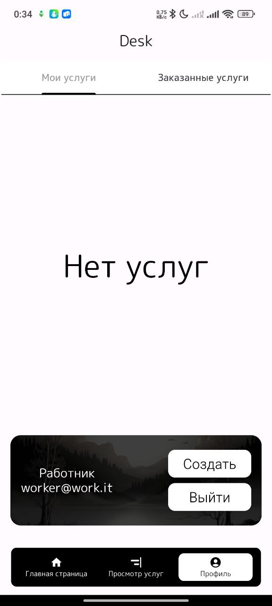
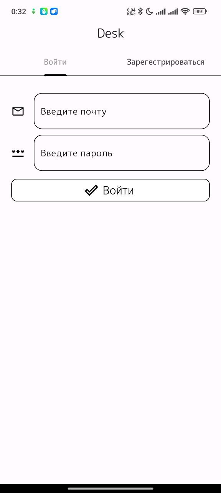
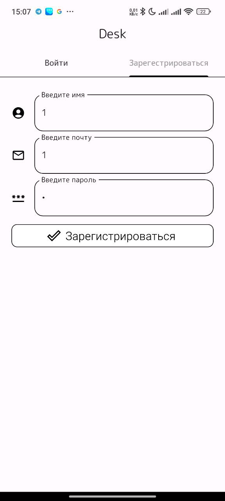

<div align="center">

# 🧰 Desk

**Мобильное приложение-биржа бытовых и профессиональных услуг**

Найдите исполнителя или предложите свою услугу — в пару нажатий.

[](https://flutter.dev)
[](https://dart.dev)
[](#-требования)
[](#-архитектура)
[](#-о-проекте)

</div>

---

## 📱 Скриншоты

> Все снимки ниже — реальные экраны приложения. Файлы лежат в [`docs/screenshots/`](docs/screenshots/) (576×1280).

<div align="center">
  
  <br>
  <sub><b>Главная страница</b> — четыре категории услуг и плавающий нижний навбар</sub>
</div>

### Галерея экранов

<table align="center">
  <tr>
    <td align="center" width="33%"><br><b>Главная страница</b><br><sub>Сетка категорий</sub></td>
    <td align="center" width="33%"><br><b>Просмотр услуг</b><br><sub>Лента доступных заказов</sub></td>
    <td align="center" width="33%"><br><b>Профиль</b><br><sub>Мои услуги и аккаунт</sub></td>
  </tr>
  <tr>
    <td align="center" width="33%"><br><b>Вход</b><br><sub>Вкладка «Войти»</sub></td>
    <td align="center" width="33%"><br><b>Регистрация</b><br><sub>Вкладка «Зарегестрироваться»</sub></td>
    <td align="center" width="33%"><br><b>Мои услуги</b><br><sub>Вкладка «Мои услуги»</sub></td>
  </tr>
  <tr>
    <td align="center" width="33%"><br><b>Создание услуги</b><br><sub>Форма новой услуги</sub></td>
    <td align="center" width="33%"><br><b>Выбор категории</b><br><sub>Выпадающий список типов</sub></td>
    <td align="center" width="33%"><br><b>Заказ принят</b><br><sub>Подтверждение заказа</sub></td>
  </tr>
</table>

### Пользовательский сценарий

<!-- ============================================================
     СКРИНШОТ 1/9 — ГЛАВНАЯ СТРАНИЦА
     Файл: docs/screenshots/Главная страница.jpg
     ============================================================ -->

#### 1️⃣ Главная страница

<p align="center">
  
</p>

<sub>Стартовый экран: четыре карточки категорий (Строительство, Программирование, Репетиторство, Сантехника). Тап по карточке открывает ленту услуг, уже отфильтрованную по этой категории.</sub>

<!-- ============================================================
     СКРИНШОТ 2/9 — ПРОСМОТР УСЛУГ
     Файл: docs/screenshots/Просмотр услуг.jpg
     ============================================================ -->

#### 2️⃣ Просмотр услуг

<p align="center">
  
</p>

<sub>Лента доступных услуг: название, краткое описание и цена в рублях. Свои и уже заказанные услуги из ленты скрываются. Полное описание — по долгому нажатию на карточку.</sub>

<!-- ============================================================
     СКРИНШОТ 3/9 — ЗАКАЗ ПРИНЯТ
     Файл: docs/screenshots/Заказ принят.jpg
     ============================================================ -->

#### 3️⃣ Заказ принят

<p align="center">
  
</p>

<sub>Подтверждение оформления заказа. Заказ сразу появляется во вкладке «Заказанные услуги» профиля. Для неавторизованного пользователя вместо этого показывается диалог с предложением войти.</sub>

<!-- ============================================================
     СКРИНШОТ 4/9 — ВХОД
     Файл: docs/screenshots/Вход.jpg
     ============================================================ -->

#### 4️⃣ Вход

<p align="center">
  
</p>

<sub>Вкладка «Войти»: почта и пароль. При неверных данных появляется снекбар «Нет такого пользователя». Демо-аккаунты — в разделе [Демо-доступ](#-демо-доступ).</sub>

<!-- ============================================================
     СКРИНШОТ 5/9 — РЕГИСТРАЦИЯ
     Файл: docs/screenshots/Регистрация.jpg
     ============================================================ -->

#### 5️⃣ Регистрация

<p align="center">
  
</p>

<sub>Вкладка «Зарегестрироваться»: имя, почта и пароль. Новый пользователь добавляется в in-memory список и сразу авторизуется.</sub>

<!-- ============================================================
     СКРИНШОТ 6/9 — ПРОФИЛЬ
     Файл: docs/screenshots/Профиль.jpg
     ============================================================ -->

#### 6️⃣ Профиль

<p align="center">
  
</p>

<sub>Вкладки «Мои услуги» / «Заказанные услуги» и карточка аккаунта с именем, почтой и кнопками «Создать» / «Выйти».</sub>

<!-- ============================================================
     СКРИНШОТ 7/9 — МОИ УСЛУГИ
     Файл: docs/screenshots/Мои услуги.jpg
     ============================================================ -->

#### 7️⃣ Мои услуги

<p align="center">
  
</p>

<sub>Список услуг, созданных текущим пользователем. Тап по карточке открывает диалог «Ваша услуга» с ценой.</sub>

<!-- ============================================================
     СКРИНШОТ 8/9 — СОЗДАНИЕ УСЛУГИ
     Файл: docs/screenshots/Создание услуги.jpg
     ============================================================ -->

#### 8️⃣ Создание услуги

<p align="center">
  
</p>

<sub>Форма новой услуги: название, описание, стоимость (принимаются только цифры) и выбор типа услуги. Открывается кнопкой «Создать» в профиле.</sub>

<!-- ============================================================
     СКРИНШОТ 9/9 — ВЫБОР КАТЕГОРИИ
     Файл: docs/screenshots/Выбор категории.jpg
     ============================================================ -->

#### 9️⃣ Выбор категории

<p align="center">
  
</p>

<sub>Модальный список типов услуг с поиском: Строительство, Программирование, Репетиторство, Сантехника. Выбранный тип подсвечивается снекбаром.</sub>

---

## ✨ Возможности

- 🏠 **Категории услуг** — строительство, программирование, репетиторство, сантехника. Тап по карточке сразу фильтрует ленту услуг.
- 📋 **Лента услуг** — карточки с названием, описанием и ценой; полное описание показывается по долгому нажатию (tooltip).
- 🛒 **Заказ услуги** — оформление заказа в один тап с подтверждающим диалогом.
- 👤 **Профиль** — вкладки «Мои услуги» и «Заказанные услуги», данные аккаунта, кнопки «Создать» и «Выйти».
- ➕ **Создание услуги** — форма с валидацией стоимости (только цифры) и выбором типа услуги из выпадающего списка.
- 🔐 **Авторизация** — вход и регистрация на вкладках одного экрана, снекбары об ошибках («Нет такого пользователя» и т. п.).
- 🚫 **Гостевой режим** — неавторизованному пользователю доступны главная и лента; при попытке заказа показывается диалог с предложением войти.
- 🎨 **Единый стиль** — шрифт M PLUS Rounded 1c, скругления, чёрно-белая тема, плавающий нижний навбар.

---

## 🧱 Архитектура

Проект построен на **BLoC/Cubit** (`flutter_bloc`) с разделением на слои:

```
UI (presentation)  →  Cubit  →  Repos  →  Данные (const/*)
```

- **`presentation/`** — экраны, виджеты и кубиты. UI подписан на состояния через `BlocBuilder` / `BlocConsumer`.
- **`repos/`** — источники данных. Сейчас это in-memory реализации, читающие демо-данные из `const/`.
- **`model/`** — доменные модели: `UserModel`, `ServiceModel`, `TypeModel`.
- **`const/`** — сид-данные (пользователи и услуги) для демонстрации работы.
- **Зависимости** прокидываются через `MultiRepositoryProvider` / `MultiBlocProvider` в [`lib/presentation/app_view.dart`](lib/presentation/app_view.dart), поэтому замена in-memory репозитория на REST/Firebase не затрагивает UI.

### Маршрутизация состояний

| Cubit | Состояния | Назначение |
|---|---|---|
| `AuthCubit` | `AuthInitial`, `UnAuthed`, `ToMain`, `ToAuth`, `Authed` | Переключение между формой входа и основным приложением |
| `NavbarCubit` | `int` | Выбранная вкладка нижней навигации |
| `ServicesCubit` | `ServicesInitial`, `ServicesLoaded`, `FilteredServicesLoaded` | Общая лента и фильтрация по категории |
| `ProfileCubit` | `ProfileInitial`, `ProfileLoaded`, `OrderedProfileLoaded`, `UnloggedProfileLoaded` | «Мои» и «Заказанные» услуги |

---

## 🛠 Технологии

| Что | Версия / пакет |
|---|---|
| Flutter SDK | `>=3.3.0 <4.0.0` |
| Dart | входит в состав SDK |
| Состояние | [`flutter_bloc`](https://pub.dev/packages/flutter_bloc) `^9.0.0` |
| Нижняя навигация | [`floating_bottom_navigation_bar`](https://pub.dev/packages/floating_bottom_navigation_bar) `^1.5.2` |
| Диалоги с GIF | [`giffy_dialog`](https://pub.dev/packages/giffy_dialog) `^2.2.0` |
| Выпадающий список | [`drop_down_list`](https://pub.dev/packages/drop_down_list) `^2.0.0` |
| Иконки | [`cupertino_icons`](https://pub.dev/packages/cupertino_icons) `^1.0.6` |
| Линтер | `flutter_lints` `^3.0.0` |

---

## 📂 Структура проекта

```
desk/
├── assets/
│   ├── fonts/                     # M PLUS Rounded 1c (7 начертаний)
│   └── images/                    # обложки категорий, фон профиля, успех.gif
├── docs/
│   └── screenshots/               # сюда кладутся скриншоты для README
├── lib/
│   ├── main.dart                  # точка входа, запуск AppView
│   ├── const/                     # сид-данные: услуги, пользователи, типы
│   ├── model/                     # UserModel, ServiceModel, TypeModel
│   ├── repos/                     # auth_repos, services_repos, user_repos
│   └── presentation/
│       ├── app_view.dart          # MaterialApp, тема, провайдеры, роутинг по AuthState
│       ├── main_form.dart         # каркас с плавающим навбаром
│       ├── cubit/                 # AuthCubit, NavbarCubit
│       ├── pages/
│       │   ├── auth/              # auth.dart, login.dart, reg.dart
│       │   ├── main/              # главная: сетка категорий
│       │   ├── services/          # лента услуг + cubit
│       │   └── profile/           # профиль, add_service.dart + cubit
│       └── widgets/               # Service, UserService, ProfileService
├── test/
│   └── widget_test.dart
└── pubspec.yaml
```

---

## 🚀 Быстрый старт

### Требования

- [Flutter SDK](https://docs.flutter.dev/get-started/install) 3.3.0 или новее (`flutter --version`)
- Android Studio + Android SDK **или** VS Code с расширением Flutter
- Подключённое устройство или запущенный эмулятор (`flutter devices`)

### Установка и запуск

```bash
# 1. Клонировать репозиторий
git clone <URL_РЕПОЗИТОРИЯ>
cd Desk

# 2. Подтянуть зависимости
flutter pub get

# 3. Запустить на подключённом устройстве/эмуляторе
flutter run
```

Полезные команды:

```bash
flutter analyze                 # статический анализ
flutter test                    # прогон тестов
flutter build apk --release     # сборка релизного APK
flutter devices                 # список доступных устройств
```

> Для сборки под Android может понадобиться файл `android/key.properties` со своими параметрами подписи — не коммитьте реальные ключи в репозиторий.

---

## 🔑 Демо-доступ

Данные берутся из [`lib/const/user_models.dart`](lib/const/user_models.dart) — регистрация тоже работает и создаёт пользователя прямо в памяти.

| Почта | Пароль |
|---|---|
| `didi@mail.ru` | `1234` |
| `miha@mail.ru` | `1234` |
| `gero@mail.ru` | `1234` |
| `yasu@mail.ru` | `1234` |

---

## ℹ️ О проекте

Учебный проект: демонстрирует построение Flutter-приложения на BLoC/Cubit со слоем репозиториев и in-memory данными. Развитие не планируется — репозиторий переведён в архив и остаётся как пример реализации.

---

## 📄 Лицензия

Лицензия не указана — проект архивный и учебный.
